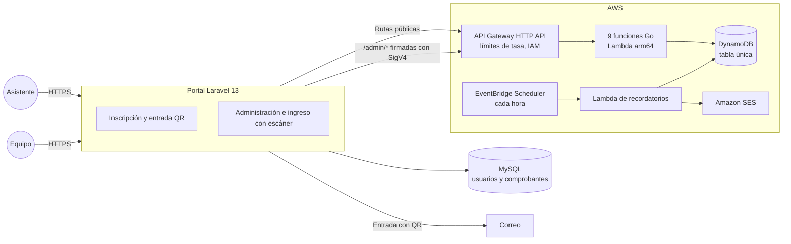

# Plataforma serverless de eventos en Go, AWS Lambda y DynamoDB, con portal Laravel y entradas QR

[](https://github.com/KevinAndrey96/go-serverless-events-platform/actions/workflows/ci.yml)


Plataforma para publicar eventos, inscribir asistentes, validar pagos por transferencia, enviar la entrada con código QR y controlar el ingreso en la puerta escaneando el QR desde el navegador. La API es serverless (Go en AWS Lambda arm64, API Gateway HTTP API y DynamoDB) y el portal de inscripción y administración está hecho en Laravel 13.

## Contenido

- [Qué resuelve](#qué-resuelve)
- [Arquitectura](#arquitectura)
- [Decisiones de arquitectura](#decisiones-de-arquitectura)
- [API](#api)
- [Portal](#portal)
- [Ejecutar en local](#ejecutar-en-local)
- [Pruebas y calidad](#pruebas-y-calidad)
- [Desplegar en AWS](#desplegar-en-aws)
- [Historia del proyecto](#historia-del-proyecto)
- [Licencia y autoría](#licencia-y-autoría)

## Qué resuelve

- **Cupos garantizados.** La inscripción y el conteo de cupos se escriben en una sola transacción condicional de DynamoDB: nunca se venden más cupos de los que hay, ni siquiera con inscripciones simultáneas.
- **Un correo, una inscripción por evento.** La unicidad del correo se garantiza en la misma transacción con un registro guardián.
- **Entradas no adivinables.** Cada entrada es `<evento>.<asistente>`, con 128 bits aleatorios para el asistente.
- **Ingreso de una sola vez.** El check-in es una escritura condicional: si dos personas escanean la misma entrada a la vez, solo una entra. Se rechazan entradas con pago pendiente.
- **Pagos por transferencia.** El asistente sube su comprobante, que se guarda en almacenamiento privado; el equipo lo revisa y confirma el pago desde el portal. Los eventos gratuitos quedan pagados automáticamente.
- **Recordatorios sin duplicados.** Cada hora una función busca los eventos de las próximas 24 horas y envía un recordatorio por SES a cada asistente, reclamando el envío antes de hacerlo para no repetirlo aunque haya reintentos.
- **Roles.** Administración (eventos, pagos, equipo) y logística (lista de asistentes e ingreso).

## Arquitectura



El backend sigue Clean Architecture con dependencias hacia adentro:

| Capa | Paquete | Responsabilidad |
| :--- | :--- | :--- |
| Dominio | `backend/internal/event` | Entidades, reglas (cupos, estados, pagos, ingreso), errores y generación de identificadores. Sin dependencias de AWS. |
| Casos de uso | `backend/internal/usecase` | Un archivo `uc_*.go` por caso de uso, cada uno con su propia interfaz pequeña de almacenamiento. |
| Adaptadores | `backend/internal/dynamo`, `backend/internal/mail` | DynamoDB (transacciones condicionales con reintentos) y SES v2. |
| Entrega | `backend/internal/handler`, `backend/cmd/*` | Un handler `h_*.go` por ruta y un `main` por Lambda; `cmd/devserver` expone las mismas rutas por HTTP para desarrollo. |

```text
.
├── backend/              API en Go (módulo independiente, golangci-lint, Dockerfile del servidor local)
│   ├── cmd/              9 Lambdas y el servidor de desarrollo
│   └── internal/         dominio, casos de uso, DynamoDB, correo, handlers, configuración
├── portal/               Laravel 13: inscripción, entrada QR, administración, escáner
├── docs/adr/             decisiones de arquitectura
├── template.yaml         infraestructura AWS SAM
├── docker-compose.yml    entorno local completo
└── .github/              CI y Dependabot
```

### Modelo de datos (tabla única)

| Entidad | PK | SK | Notas |
| :--- | :--- | :--- | :--- |
| Evento | `EVENT#<id>` | `EVENT` | `registered` y `capacity` en el mismo ítem; `GSI1` (`EVENTS`, `<inicio UTC>#<id>`) lista por fecha |
| Asistente | `EVENT#<id>` | `ATTENDEE#<id>` | Estado de pago, ingreso y recordatorio |
| Guardián de correo | `EVENT#<id>` | `EMAIL#<correo>` | Garantiza una inscripción por correo y evento |

## Decisiones de arquitectura

| ADR | Decisión |
| :--- | :--- |
| [0001](docs/adr/0001-record-architecture-decisions.md) | Registrar las decisiones de arquitectura |
| [0002](docs/adr/0002-dynamodb-single-table-design.md) | Diseño de tabla única en DynamoDB |
| [0003](docs/adr/0003-conditional-writes-for-capacity-and-check-in.md) | Escrituras condicionales para cupos e ingreso |
| [0004](docs/adr/0004-scheduled-reminders-with-claims.md) | Recordatorios programados con reclamo previo |
| [0005](docs/adr/0005-iam-authorization-for-organizer-routes.md) | Autorización IAM para las rutas de organizadores |

## API

| Método | Ruta | Acceso | Descripción |
| :--- | :--- | :--- | :--- |
| `GET` | `/events` | Público | Eventos próximos y abiertos, con cupos disponibles |
| `POST` | `/events/{eventId}/attendees` | Público (límite más estricto) | Inscripción; responde con la entrada |
| `GET` | `/admin/events` | IAM | Todos los eventos con aforo e inscritos |
| `POST` | `/admin/events` | IAM | Crear evento |
| `PATCH` | `/admin/events/{eventId}/status` | IAM | Abrir o cerrar inscripciones |
| `GET` | `/admin/events/{eventId}/attendees` | IAM | Asistentes del evento |
| `PATCH` | `/admin/events/{eventId}/attendees/{attendeeId}/payment` | IAM | Confirmar o revertir un pago |
| `POST` | `/admin/check-ins` | IAM | Validar una entrada en la puerta |

Los errores tienen siempre la forma `{"error": "event_full", "message": "...", "field": "..."}`, con códigos estables (`validation`, `event_not_found`, `event_full`, `already_registered`, `already_checked_in`, `payment_pending`, entre otros) que el portal traduce al español.

## Portal

| Ruta | Quién | Descripción |
| :--- | :--- | :--- |
| `/` | Público | Próximos eventos |
| `/eventos/{id}/inscripcion` | Público | Formulario de inscripción con comprobante de pago |
| `/entrada` | Público | Entrada con QR tras inscribirse (también llega por correo) |
| `/admin/eventos` | Equipo | Eventos, asistentes, comprobantes y pagos |
| `/admin/ingreso` | Equipo | Escáner QR con la cámara del navegador |
| `/admin/equipo` | Administración | Alta de usuarios de logística |

El portal agrega cabeceras de seguridad, límites de tasa en inscripción, ingreso y login, y guarda los comprobantes fuera del directorio público.

## Ejecutar en local

Requisitos: Docker con Compose.

```bash
make up    # docker compose up --build -d
```

| Servicio | URL |
| :--- | :--- |
| Portal | http://localhost:8081 (usuario `admin@example.com`, clave `admin-local-2026`) |
| API (servidor de desarrollo) | http://localhost:8080 |
| Mailpit (correos enviados) | http://localhost:8025 |
| DynamoDB Local | http://localhost:8000 |

Las credenciales son solo para el entorno local. Para disparar los recordatorios a mano: `curl -X POST localhost:8080/admin/reminders`.

## Pruebas y calidad

```bash
make test       # Go con DynamoDB Local (incluye concurrencia real) y PHPUnit en Docker
make lint       # golangci-lint, Larastan nivel 8 y Pint
make validate   # cfn-lint sobre template.yaml
```

- **Go:** pruebas de tabla en paralelo para dominio, casos de uso y handlers, y pruebas de integración contra DynamoDB Local: 30 inscripciones simultáneas para 10 cupos, 5 escaneos simultáneos de la misma entrada y reclamos de recordatorios.
- **Portal:** pruebas de funcionalidad con la API simulada (inscripción, comprobantes, roles, ingreso, correo con QR) y pruebas unitarias del cliente HTTP.
- **CI:** lint y pruebas de Go, validación y compilación de la plantilla SAM, portal en PHP 8.3, 8.4 y 8.5, y un flujo de punta a punta sobre Docker Compose.

## Desplegar en AWS

Requisitos: AWS SAM CLI, Go 1.26 y una identidad verificada en SES.

```bash
sam build
sam deploy --guided --parameter-overrides MailFrom=eventos@tu-dominio.com SesIdentity=tu-dominio.com
```

La plantilla crea la tabla (con recuperación a un punto en el tiempo y cifrado), el HTTP API con límites de tasa y registros de acceso, las 9 funciones con permisos mínimos y X-Ray, el programador de recordatorios y la política `PortalInvokePolicyArn`, que debe asignarse al rol con el que corre el portal. En el portal se configuran `EVENTS_API_URL` con la salida `ApiUrl` y `EVENTS_API_SIGN=true`.

## Historia del proyecto

La primera versión se desarrolló en 2023 para Instance Shape SAS en dos repositorios (una API Go con Serverless Framework y un portal Laravel 9). En 2026 se unificó en este monorepo y se reescribió por completo:

- La API no tenía autenticación y respondía con CORS abierto; ahora las rutas de organizadores exigen IAM.
- Los códigos QR eran adivinables (`User#` seguido de 6 caracteres hexadecimales); ahora usan 128 bits aleatorios.
- El escáner validaba descargando todos los asistentes; ahora es una escritura condicional por entrada.
- No había control de aforo; ahora es transaccional.
- Los comprobantes de pago quedaban públicos; ahora están en almacenamiento privado.
- Los recordatorios salían cada 6 horas y podían repetirse; ahora son horarios y con reclamo previo.
- El administrador inicial estaba fijo en el código; ahora se configura por variables de entorno.
- Se retiró el envío de invitaciones a terceros desde el formulario público, que podía usarse para enviar correo no deseado.

## Licencia y autoría

Código desarrollado por **Kevin Andrey Herrera Silva** ([@KevinAndrey96](https://github.com/KevinAndrey96), [LinkedIn](https://www.linkedin.com/in/kevinandrey96/)) a partir de un proyecto realizado para Instance Shape SAS. Se publica como muestra de portafolio sin licencia de código abierto: todos los derechos reservados.
