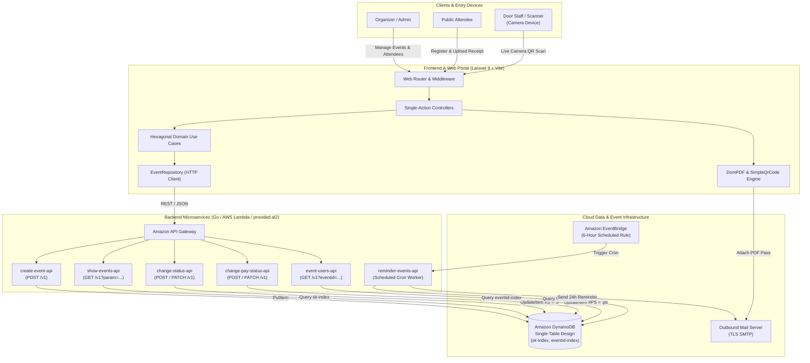
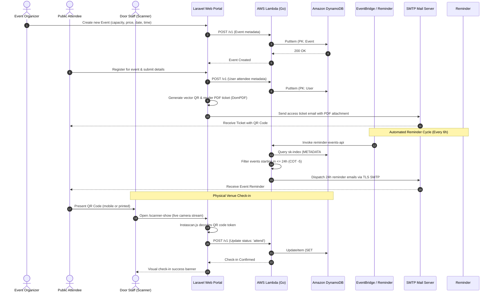

# Serverless Events Platform

[](https://github.com/KevinAndrey96/serverless-events-platform/actions/workflows/ci.yml)
[](https://golang.org)
[](https://aws.amazon.com/lambda/)
[](https://aws.amazon.com/dynamodb/)
[](https://www.serverless.com/)
[](https://laravel.com)
[](https://vitejs.dev/)
[](https://github.com/schmich/instascan)
[](LICENSE)

An enterprise-grade, event-driven full-stack platform engineered as a polyglot monorepo. The architecture combines a high-performance **Go (Golang) AWS Serverless microservices backend** with a **Laravel 9 & Vite full-stack administrative and public portal**.

The platform powers the end-to-end lifecycle of events and ticketing: organizer governance, public attendee self-registration, viral friend referrals, automated vector QR code pass generation and PDF delivery, cron-scheduled 24-hour reminder dispatches via TLS SMTP, and physical venue check-in via an in-browser live camera QR scanner.

---

## System Architecture



---

## End-to-End User & Ticketing Flow



---

## Monorepo Project Structure

```
serverless-events-platform/
├── backend/                       # Go AWS Serverless Microservices Platform
│   ├── pkg/
│   │   ├── config/                # AWS SDK session singleton & dynamic env configuration
│   │   ├── models/                # Strongly-typed domain representations & DDB mappings
│   │   └── response/              # Standard CORS & structured JSON API responses
│   ├── create/                    # POST /v1: Event & ticket registration
│   │   ├── serverless.yml
│   │   └── v1/main.go
│   ├── show/                      # GET /v1: Catalog search on GSI (sk-index)
│   │   ├── serverless.yml
│   │   └── v1/main.go
│   ├── change_status/             # POST / PATCH /v1: Event lifecycle transition
│   │   ├── serverless.yml
│   │   └── v1/main.go
│   ├── change_pay_status/         # POST / PATCH /v1: Payment reconciliation
│   │   ├── serverless.yml
│   │   └── v1/main.go
│   ├── event-users/               # GET /v1: Attendee query on GSI (eventid-index)
│   │   ├── serverless.yml
│   │   └── v1/main.go
│   ├── reminder/                  # Scheduled Worker: 24h TLS SMTP reminder cron
│   │   ├── serverless.yml
│   │   └── v1/main.go
│   ├── Makefile                   # Service-level Go compilation & test rules
│   ├── go.mod
│   └── go.sum
├── frontend/                      # Laravel 9 + Vite Full-Stack Application
│   ├── app/
│   │   ├── Http/Controllers/      # Single-Action Invokable Controllers
│   │   │   ├── Events/            # Event creation, catalog & attendees
│   │   │   ├── Records/           # Public enrollment & friend referrals
│   │   │   ├── Scanner/           # Live video camera QR validator
│   │   │   └── Attendee/          # Payment audit & approval
│   │   ├── Repositories/          # Domain contracts & HTTP client implementations
│   │   └── UsesCases/             # Hexagonal application business logic
│   ├── config/services.php        # Centralized microservices endpoint map
│   ├── resources/views/           # Blade templates (Dashboard, Scanner, PDF Pass)
│   ├── routes/web.php             # Route definitions
│   └── package.json
├── Makefile                       # Root monorepo build & test orchestrator
└── README.md
```

---

## DynamoDB Single-Table Schema & Access Patterns

The backend consolidates all domain entities into a single DynamoDB table to achieve predictable sub-10ms performance at scale.

### Key Structure & Secondary Indexes

| Entity | Partition Key (`pk`) | Sort Key (`sk`) | GSI: `sk-index` (PK) | GSI: `eventid-index` (PK) | Attributes |
|---|---|---|---|---|---|
| **Event Metadata** | `Event#<UUID>` | `METADATA#EVENT` | `METADATA#EVENT` | — | `name`, `capacity`, `price`, `date`, `hour`, `status`, `bank`, `account` |
| **Attendee / Ticket** | `User#<UUID>` | `METADATA#USER` | `METADATA#USER` | `Event#<UUID>` | `name`, `lastname`, `email`, `phone`, `status`, `paymentstatus`, `scholarship` |

### Access Pattern Matrix

| Access Pattern | Microservice | Query Target | Method |
|---|---|---|---|
| Register Event or Attendee | `create-event-api` | Table | `PutItem` |
| List Events Catalog | `show-events-api` | `sk-index` (`sk = METADATA#EVENT`) | `Query` |
| Retrieve Attendees for an Event | `event-users-api` | `eventid-index` (`eventid = Event#<UUID>`) | `Query` |
| Transition Event State | `change-status-api` | Table (`pk`, `sk`) | `UpdateItem` |
| Confirm Payment Status | `change-pay-status-api` | Table (`pk`, `sk`) | `UpdateItem` |
| Evaluate Upcoming Reminders | `reminder-events-api` | `sk-index` (`sk = METADATA#USER`) + `GetItem` Event | `Query` + `GetItem` |

---

## Microservices Integration Contracts

The frontend interacts with the Go backend via HTTP/REST contracts defined in `frontend/config/services.php`:

| Operation | Environment Variable | HTTP Method | Payload / Query |
|---|---|---|---|
| Catalog Query | `URL_SHOW_EVENTS_USERS` | `GET` | `?param=EVENT` |
| Create Event / Attendee | `URL_CREATE_EVENTS` | `POST` | Entity JSON payload |
| Update Status | `URL_CHANGE_STATUS_USERS_EVENTS` | `POST` / `PATCH` | `{"pk": "...", "sk": "...", "status": "..."}` |
| Query Event Attendees | `URL_EVENT_USERS` | `GET` | `?param={eventID}` |
| Reconcile Payment | `URL_CHANGE_PAY_STATUS` | `POST` / `PATCH` | `{"pk": "...", "sk": "...", "status": "PAID"}` |

---

## Engineering Highlights & Design Patterns

1. **Polyglot Monorepo Architecture:**
   - Single source of truth with unified root orchestration (`Makefile`).
   - Clean domain boundaries: Go for high-throughput, low-latency microservices and scheduled background workers; Laravel for rapid, expressive web UI, validation, and PDF rendering.

2. **Decoupled Hexagonal / Clean Architecture:**
   - The Laravel web portal defines `EventRepositoryInterface`, ensuring controllers and use cases depend exclusively on abstractions.
   - Resilient HTTP communication: includes timeouts (10s), error handling, and structured logging (`Log::error`).

3. **12-Factor App & Zero Hardcoded Secrets:**
   - Fully sanitized codebase: all database credentials, API endpoints, and mail credentials are injected via environment variables (`.env`).
   - Automated dry-run mode: the reminder background worker safely skips outbound dispatches when `SMTP_PASS` is omitted in staging environments without panicking.

4. **Hardware Integration in Modern Web:**
   - Client-side live camera stream decoding powered by `Instascan.js`.
   - Native device camera detection with mobile rear-camera selection for contactless gate check-in.

---

## Quickstart & Local Setup

### 1. Root Monorepo Commands
```bash
# Start local DynamoDB, Admin UI, MySQL & Mailpit
make docker-up

# Run all unit test suites
make test

# Compile all Go Lambda binaries
make build

# Stop local Docker environment
make docker-down
```

### 2. Local Infrastructure Services (Docker Compose)
| Service | Container Port | Host Port | Purpose / Dashboard |
| :--- | :---: | :---: | :--- |
| **DynamoDB Local** | `8000` | `8000` | Local AWS DynamoDB engine for offline Lambda invocation |
| **DynamoDB Admin** | `8001` | `8001` | Web UI at [http://localhost:8001](http://localhost:8001) to inspect single-table items |
| **MySQL 8.0** | `3306` | `3306` | Relational store for the Laravel administrative portal |
| **Mailpit** | `1025 / 8025` | `1025 / 8025` | SMTP sink + Webmail at [http://localhost:8025](http://localhost:8025) for reminder emails |

### 3. Backend Deployment (Go / AWS Lambda)
Prerequisites: Go 1.20+, Serverless Framework v3 (`npm install -g serverless`), configured AWS CLI.
```bash
cd backend/create
serverless deploy --stage dev
```
*(Repeat for each microservice under `backend/`)*

### 3. Frontend Setup (Laravel 9 / Vite)
Prerequisites: PHP 8.1+, Composer, Node.js 18+.
```bash
cd frontend

# Install dependencies
composer install
npm install

# Environment configuration
cp .env.example .env
php artisan key:generate

# Run migrations & seeders
php artisan migrate --seed

# Build assets & start dev server
npm run build
php artisan serve
```
Open `http://localhost:8000` to access the portal.

---

## Author
**Kevin Andrey Herrera Silva**
- GitHub: [@KevinAndrey96](https://github.com/KevinAndrey96)
- LinkedIn: [Kevin Andrey Herrera Silva](https://www.linkedin.com/in/kevinandrey96/)
