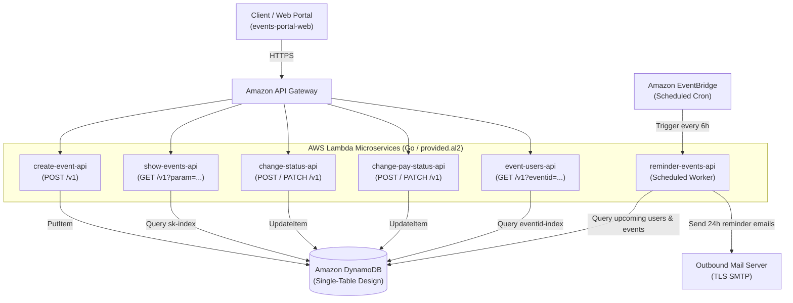

# Go Serverless Events API

[](https://golang.org)
[](https://aws.amazon.com/lambda/)
[](https://aws.amazon.com/dynamodb/)
[](https://www.serverless.com/)
[](LICENSE)

An enterprise-ready, event-driven serverless backend engineered in **Go (Golang)** and deployed on **AWS Lambda** via the **Serverless Framework**. The platform manages the end-to-end lifecycle of events and attendee ticketing—including event registration, attendee check-in tracking, payment confirmation, and automated cron-based reminder notifications via TLS SMTP.

Data persistence is powered by **Amazon DynamoDB** leveraging an optimized **Single-Table Design** pattern with Global Secondary Indexes (GSIs).

---

## Architecture Overview



---

## DynamoDB Single-Table Schema & Access Patterns

The system consolidates both **Events** and **User Attendees / Tickets** into a single DynamoDB table to achieve sub-10ms response times and predictable scaling.

### Key Structure & Secondary Indexes

| Entity | Partition Key (`pk`) | Sort Key (`sk`) | GSI: `sk-index` (PK) | GSI: `eventid-index` (PK) | Attributes |
|---|---|---|---|---|---|
| **Event Metadata** | `Event#<UUID>` | `METADATA#EVENT` | `METADATA#EVENT` | — | `name`, `capacity`, `price`, `date`, `hour`, `status`, `bank`, `account` |
| **Attendee / Ticket** | `User#<UUID>` | `METADATA#USER` | `METADATA#USER` | `Event#<UUID>` | `name`, `lastname`, `email`, `phone`, `status`, `paymentstatus`, `scholarship` |

### Access Pattern Matrix

| Access Pattern | Method / Target | Operation |
|---|---|---|
| Create event or register attendee | `POST /v1` | `PutItem` on Table |
| List events by category / metadata | `GET /v1?param=EVENT` | `Query` on `sk-index` where `sk = METADATA#EVENT` |
| Retrieve attendees for a specific event | `GET /v1?eventid=<UUID>` | `Query` on `eventid-index` where `eventid = Event#<UUID>` |
| Update event approval status | `PATCH /v1` (status) | `UpdateItem` with `#S = :s` on `(pk, sk)` |
| Confirm attendee payment status | `PATCH /v1` (payment) | `UpdateItem` with `#S = :s` on `(pk, sk)` |
| Scan upcoming attendees within 24h | EventBridge Cron Worker | `Query` on `sk-index` (`METADATA#USER`) + `GetItem` parent event |

---

## Microservices Catalog

| Service | Route | Method | Description | IAM Permissions |
|---|---|---|---|---|
| `create` | `/v1` | `POST` | Registers a new event or ticket | `dynamodb:PutItem` |
| `show` | `/v1?param=EVENT` | `GET` | Queries events by secondary index | `dynamodb:Query` (sk-index) |
| `change_status` | `/v1` | `POST`, `PATCH` | Updates event approval / lifecycle status | `dynamodb:UpdateItem` |
| `change_pay_status` | `/v1` | `POST`, `PATCH` | Updates ticket payment status (PAID/PENDING) | `dynamodb:UpdateItem` |
| `event-users` | `/v1?eventid={id}` | `GET` | Fetches attendees registered for an event | `dynamodb:Query` (eventid-index) |
| `reminder` | CloudWatch Event | `cron` | Scheduled worker: sends 24h email reminder | `dynamodb:Query`, `dynamodb:GetItem` |

---

## Project Structure

```
go-serverless-events-api/
├── pkg/
│   ├── config/             # AWS session singleton & environment configuration
│   │   ├── config.go
│   │   └── config_test.go
│   ├── models/             # Shared domain data models & payloads
│   │   ├── models.go
│   │   └── models_test.go
│   └── response/           # API Gateway standard JSON response & CORS helpers
│       ├── response.go
│       └── response_test.go
├── create/                 # Event creation microservice
│   ├── serverless.yml
│   └── v1/main.go
├── show/                   # Event catalog query microservice
│   ├── serverless.yml
│   └── v1/main.go
├── change_status/          # Event lifecycle state transition microservice
│   ├── serverless.yml
│   └── v1/main.go
├── change_pay_status/      # Attendee payment confirmation microservice
│   ├── serverless.yml
│   └── v1/main.go
├── event-users/            # Event attendee retrieval microservice
│   ├── serverless.yml
│   └── v1/main.go
├── reminder/               # Scheduled TLS SMTP reminder background worker
│   ├── serverless.yml
│   └── v1/main.go
├── Makefile                # Cross-compilation & test automation
├── go.mod
└── go.sum
```

---

## Engineering Highlights & Design Patterns

1. **Clean Architecture & Separation of Concerns:**
   Shared logic is isolated in `pkg/`:
   - `pkg/config`: Centralizes AWS SDK session creation, client reuse across invocations, and dynamic environment variable resolution (`EVENTS_TABLE_NAME`, `AWS_REGION`).
   - `pkg/models`: Strongly-typed domain representations with explicit `dynamodbav` mapping tags.
   - `pkg/response`: Consistent CORS-enabled JSON response formatting and structured error bodies (`API_ERROR`).

2. **12-Factor App & Security Sanitization:**
   - Zero hardcoded secrets: All credentials (database table names, SMTP credentials) are injected strictly via environment variables (`SMTP_HOST`, `SMTP_PORT`, `SMTP_USER`, `SMTP_PASS`).
   - Dry-Run Safe: When `SMTP_PASS` is omitted in test environments, the reminder worker executes safely in dry-run mode without crashing or throwing panics.
   - Least Privilege IAM: Each Serverless function definition requests only the exact IAM DynamoDB actions and index ARN scopes necessary for its operation.

3. **Optimized AWS Lambda Runtime:**
   - Compiled for `provided.al2` runtime using Go static compilation flags (`-ldflags="-s -w" -tags lambda.norpc`), producing sub-15MB deployment binaries for cold-start latency reduction.

---

## Local Development & Testing

### Prerequisites
- Go 1.20+
- AWS CLI configured with appropriate credentials
- Serverless Framework v3 (`npm install -g serverless`)

### Run Unit Tests
```bash
make test
```

### Build All Microservices
```bash
make build
```
Binaries will be output to `./bin/<service-name>`.

### Deploying a Microservice
Navigate to the desired service directory and deploy via Serverless Framework:
```bash
cd create
serverless deploy --stage dev
```

---

## Environment Variables

| Variable | Default | Purpose |
|---|---|---|
| `EVENTS_TABLE_NAME` | `events-testing-table` | Target DynamoDB single table |
| `AWS_REGION` | `us-east-1` | AWS deployment region |
| `SMTP_HOST` | `mail.events.instanceshape.com` | Mail server hostname for reminders |
| `SMTP_PORT` | `465` | TLS SMTP port |
| `SMTP_USER` | `no-responder@events.instanceshape.com` | Outbound sender email username |
| `SMTP_PASS` | — | Outbound sender email password |
| `FROM_EMAIL` | `no-responder@events.instanceshape.com` | Display address on reminder emails |

---

## Author
**Kevin Andrey Herrera Silva**
- GitHub: [@KevinAndrey96](https://github.com/KevinAndrey96)
- LinkedIn: [Kevin Andrey Herrera Silva](https://www.linkedin.com/in/kevinandrey96/)
