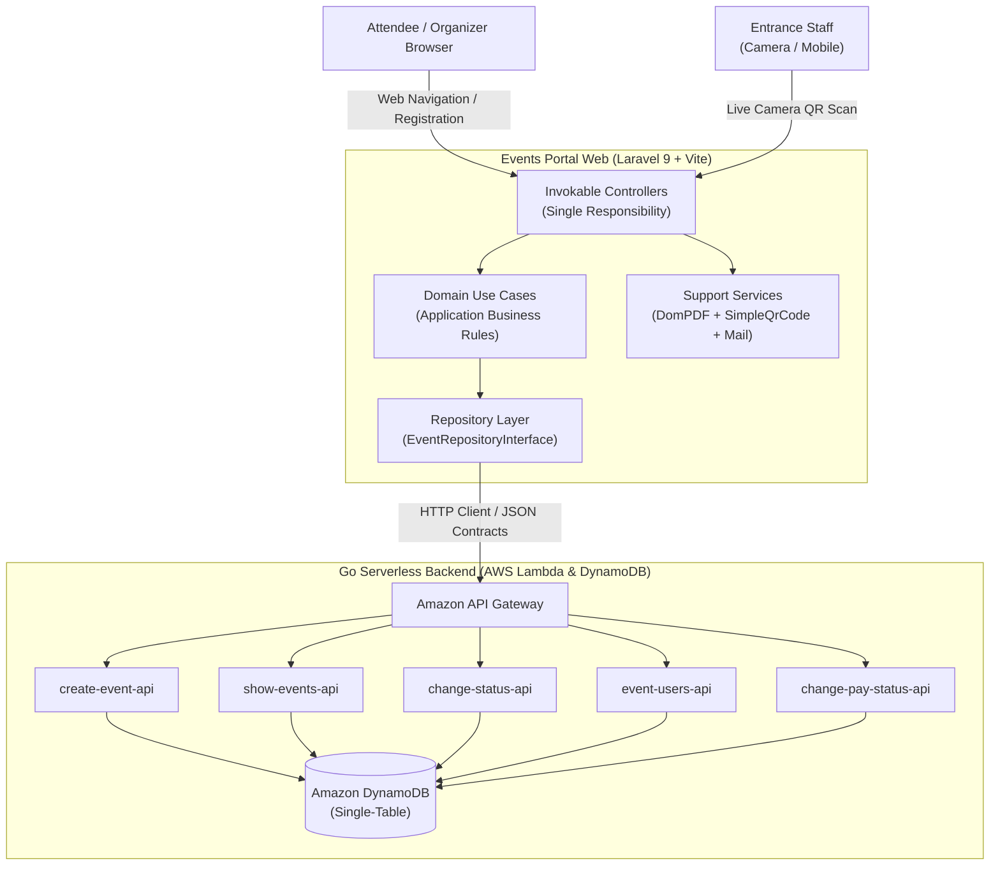

# Events Portal Web

[](https://laravel.com)
[](https://php.net)
[](https://vitejs.dev/)
[](https://github.com/schmich/instascan)
[](https://github.com/barryvdh/laravel-dompdf)
[](LICENSE)

A full-stack event scheduling, attendee ticketing, and contactless entrance validation portal engineered in **Laravel 9** and **Vite**. The portal features real-time in-browser camera QR code scanning for physical venue check-in, automated PDF ticket pass generation with dynamic QR codes, receipt attachment validation, and peer-to-peer invitation workflows.

The application is architected following **Clean Architecture / Hexagonal patterns** (Use Cases, Domain Repositories, Service Providers, and Single-Action Invokable Controllers), communicating directly with the decoupled [go-serverless-events-api](https://github.com/KevinAndrey96/go-serverless-events-api) microservices on AWS Lambda and Amazon DynamoDB.

---

## Architecture Overview



---

## Core Capabilities

1. **Event Scheduling & Governance:**
   - Event creation with capacity limits, scheduled start date and hour, dynamic ticket pricing, and banking payment destination coordinates.
   - Lifecycle state toggles (`enabled` / `disabled` / `cancelled`).

2. **Public Self-Registration & Referrals:**
   - Public-facing attendee enrollment form (`/records-create/{pk}`) with scholarship requests and payment receipt upload.
   - Viral peer invitation: sends direct event registration invitations to referred friends via email.

3. **Automated PDF Ticket Passes & Email Delivery:**
   - Generates high-resolution vector QR code access passes uniquely encoded with attendee partition keys.
   - Converts passes into standalone PDF ticket documents via **DomPDF** and automatically emails them as attachments upon registration.

4. **In-Browser Live Camera QR Scanner:**
   - Powered by `Instascan.js` directly within the browser (`/scanner-show`).
   - Accesses device camera streams (supporting rear camera auto-detection on mobile devices) to scan physical or mobile attendee QR tickets at venue doors.
   - Instant verification and state transition (`not-attend` ➡️ `attend`) with zero external hardware required.

5. **Financial & Attendee Reconciliation:**
   - Administrative review of attendee rosters per event (`/events-attendees/{id}`).
   - Payment status auditing (`not-payed` ➡️ `paid`) with on-screen payment receipt proof inspection.

---

## Clean Architecture Directory Structure

The project decouples framework delivery mechanisms from core application logic through strict interface boundaries:

```
events-portal-web/
├── app/
│   ├── Http/
│   │   └── Controllers/
│   │       ├── Attendee/           # Payment reconciliation controllers
│   │       ├── Events/             # Event management single-action controllers
│   │       ├── Records/            # Public registration & ticket generation controllers
│   │       ├── Scanner/            # Live video QR scanner controller
│   │       └── Users/              # User administration & QR validation controllers
│   ├── Repositories/
│   │   ├── Contracts/              # Repository interfaces
│   │   │   ├── Events/EventRepositoryInterface.php
│   │   │   └── Users/UserRepositoryInterface.php
│   │   ├── Events/EventRepository.php # HTTP integration with Go Serverless microservices
│   │   └── Users/UserRepository.php
│   ├── UsesCases/
│   │   ├── Contracts/              # Use case interfaces
│   │   └── Events/ & Users/        # Orchestrated business logic
│   └── Providers/
│       ├── RepositoriesServiceProvider.php # IoC binding for repositories
│       └── UseCaseServiceProvider.php      # IoC binding for application use cases
├── config/
│   └── services.php                # Microservice endpoints configuration
├── resources/
│   └── views/                      # Blade templates (Dashboard, Scanner, PDF Tickets)
└── routes/
    └── web.php                     # Route definitions
```

---

## Microservices Integration Matrix

`EventRepository` communicates with the following endpoints exposed by `go-serverless-events-api`:

| Operation | Microservice URL Config | Request Method | Payload / Query |
|---|---|---|---|
| Query Catalog | `services.events_api.show` | `GET` | `?param=EVENT` |
| Create Event / Attendee | `services.events_api.create` | `POST` | Event or Attendee JSON entity |
| Update Event Status | `services.events_api.change_status` | `POST` / `PATCH` | `{"pk": "...", "sk": "...", "status": "..."}` |
| Query Event Attendees | `services.events_api.event_users` | `GET` | `?param={eventID}` |
| Update Payment Status | `services.events_api.change_pay_status` | `POST` / `PATCH` | `{"pk": "...", "sk": "...", "status": "PAID"}` |

---

## Setup & Local Development

### Prerequisites
- PHP 8.1+ with extensions: `pdo_mysql`, `openssl`, `mbstring`, `gd`
- Composer 2.x
- Node.js 18+ and npm
- MySQL / MariaDB (or SQLite for testing)

### Installation Steps

1. **Clone the repository:**
   ```bash
   git clone git@github.com:KevinAndrey96/events-portal-web.git
   cd events-portal-web
   ```

2. **Install PHP and Node dependencies:**
   ```bash
   composer install
   npm install
   ```

3. **Configure Environment:**
   ```bash
   cp .env.example .env
   php artisan key:generate
   ```
   Update `.env` with your database credentials and the deployed API Gateway endpoint URLs for the Go serverless microservices.

4. **Run Database Migrations & Seeders:**
   ```bash
   php artisan migrate --seed
   ```

5. **Link Storage & Build Frontend Assets:**
   ```bash
   php artisan storage:link
   npm run build
   ```

6. **Start Local Development Server:**
   ```bash
   php artisan serve
   ```
   Open `http://127.0.0.1:8000` in your browser.

---

## Author
**Kevin Andrey Herrera Silva**
- GitHub: [@KevinAndrey96](https://github.com/KevinAndrey96)
- LinkedIn: [Kevin Andrey Herrera Silva](https://www.linkedin.com/in/kevinandrey96/)
